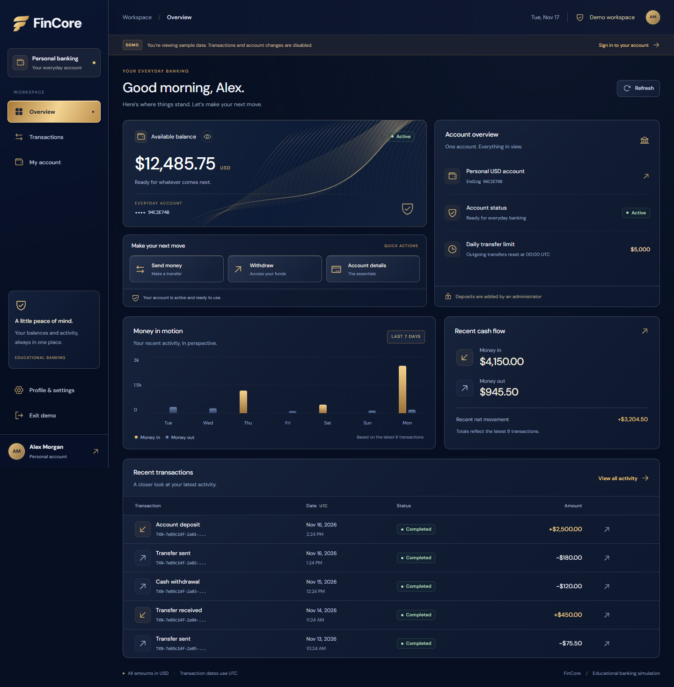

# FinCore

A full-stack USD banking simulation built with Java, Spring Boot, PostgreSQL, React, and TypeScript. Customers manage accounts and transactions; administrators review applications, fund accounts, and control account status.



## Features

- Customer registration, JWT authentication, and role-based access.
- Application approval and account lifecycle management.
- Deposits, withdrawals, and atomic transfers with exact decimal amounts.
- Actor-scoped idempotency keys for safely retrying financial requests.
- Ordered database row locks, rollback, balance constraints, and UTC daily transfer limits.
- Searchable transaction history, receipts, CSV export, and responsive customer/admin dashboards.
- Read-only demo mode with synthetic data, available without a backend.
- Interactive, offline [architecture guide](architecture.html).

## Stack

Java 21, Spring Boot 3.5, Spring Security, Hibernate/JPA, Flyway, PostgreSQL 17, Maven Wrapper; React 19, TypeScript, Vite, Tailwind CSS, Radix UI, and Playwright.

## Run locally

Requires Docker Compose and Node.js 22.18 or later. The containers provide Java and PostgreSQL.

1. Clone this repository and open its directory.
2. Copy `.env.example` to `.env`. Replace every placeholder with your own credentials. Use a random JWT secret of at least 32 bytes. The administrator credentials bootstrap an administrator on an empty database.
3. Start the database and API:

   ```sh
   docker compose up -d --build
   ```

4. In a separate terminal, start the frontend:

   ```sh
   cd frontend
   npm ci
   npm run dev
   ```

Open **http://localhost:5173**. API documentation: **http://localhost:8081/swagger-ui/index.html**. The frontend forwards `/api` requests to port 8081. Compose binds the API and database to localhost. If port 5432 is occupied, change the database host port in `compose.yml`; the container connection still uses `db:5432`.

Register a customer, sign in as the administrator to approve the application and deposit funds, then sign in as the customer to exercise transactions. Transfer recipients must also be approved. Demo mode is explicitly separate from live accounts.

Stop containers with `docker compose down`; the named database volume persists. See [development instructions](docs/development.md) for running Java and PostgreSQL without Docker.

## Business rules

All accounts use USD. Deposits are limited to $10,000 per request; outgoing transfers are limited to $5,000 per UTC day. Money operations require positive amounts with at most two decimal places. Frozen or closed accounts cannot move money. Authorization and account ownership are enforced by the backend.

## Verification

With Java 21 installed:

```sh
# Windows: use .\mvnw.cmd instead of bash ./mvnw
bash ./mvnw -B spotless:check verify
```

Docker enables the PostgreSQL Testcontainers integration suite. Without Docker, those cases are skipped; [development instructions](docs/development.md) describe the opt-in disposable database alternative.

```sh
cd frontend
npm ci
npm run format:check
npm test
npm run build
npx playwright install chromium
npm run test:e2e
npm run test:guide
```

Browser tests mock API responses; backend integration tests exercise real PostgreSQL. GitHub Actions runs both jobs on pushes and pull requests.

## Project layout

```text
src/main/java/com/fincore/
  controller/       HTTP endpoints
  service/          Business rules and transaction boundaries
  repository/       Queries and locking
  entity/           Persistence mappings
  dto/              Validated inputs and response contracts
  security/         JWT and password configuration
src/main/resources/db/migration/   Versioned SQL schema
src/test/                         Unit and PostgreSQL integration tests
frontend/src/
  pages/            Customer, administrator, and authentication screens
  components/       Workspace shell, dialogs, tables, and shared UI
  hooks/            Asynchronous loading lifecycle
  data/             Synthetic demo fixtures
  api.ts            HTTP boundary and error handling
frontend/tests/                   Logic, browser, and guide tests
```

See [API notes](docs/api.md), [architecture.html](architecture.html), and [contributing](CONTRIBUTING.md).

## Scope

FinCore is an educational portfolio project, not a service for real funds. It does not integrate with payment networks or implement regulatory onboarding. Production deployment would require environment-specific TLS, secret management, monitoring, backups, and operational controls. JWTs live in frontend memory; refreshing the page requires signing in again.
